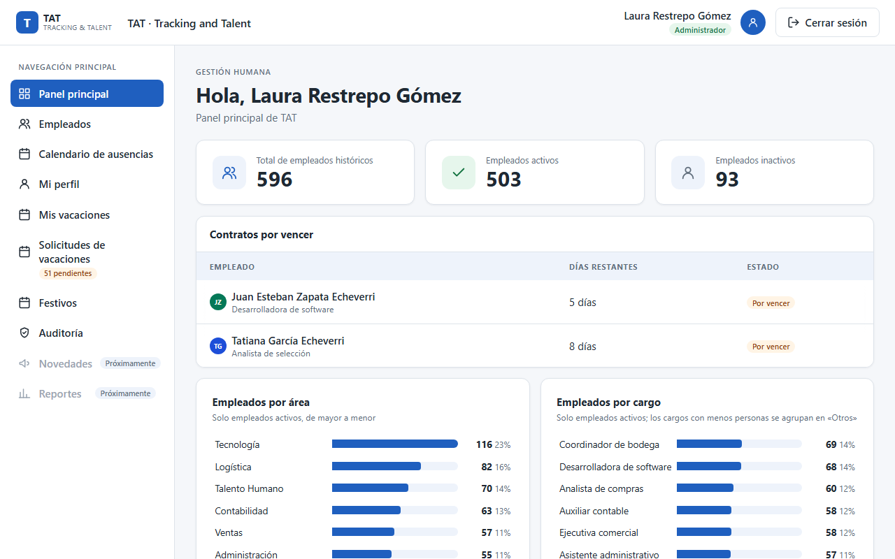

# TAT · Tracking and Talent

Sistema web de gestión de talento humano: expediente de empleados, contratos, vacaciones con saldo calculado, auditoría y un panel gerencial con roles y permisos.

Proyecto final de **Ingeniería de Software II** — Institución Universitaria Pascual Bravo, 2026-2.

| | |
|---|---|
| **Aplicación** | https://tat-woad.vercel.app |
| **Repositorio** | https://github.com/tabordaa/TAT |
| **Gestión del proyecto** | Azure DevOps, proyecto `TAT` (Scrum, 5 sprints) |
| **Documentación** | [Arquitectura](docs/ARQUITECTURA.md) · [Manual de usuario](docs/MANUAL_USUARIO.md) · [Despliegue](docs/DEPLOYMENT.md) · [Pruebas E2E](docs/E2E.md) |



## Qué hace

| Módulo | Funcionalidad |
|---|---|
| **Identidad y seguridad** | Inicio y cierre de sesión, cambio obligatorio de contraseña en el primer acceso, creación de cuentas y restablecimiento de contraseña por el administrador, cuatro roles con permisos distintos. |
| **Empleados** | Registro (onboarding), directorio con búsqueda, filtros y paginación, expediente completo, actualización de cargo, área y salario con historial salarial, foto de perfil y exportación a CSV. |
| **Portal del empleado** | Mi perfil, actualización de teléfono y dirección, foto y **certificado laboral en PDF** con código de verificación. |
| **Contratos** | Asignación (ingreso y reingreso), alertas de contratos por vencer y finalización de contrato. |
| **Vacaciones** | Solicitud con conteo de días hábiles (sin fines de semana ni festivos de Colombia), saldo calculado (15 días hábiles por año), aprobación o rechazo con motivo, cancelación, notificaciones y calendario de ausencias por área. |
| **Auditoría y panel** | Registro de quién cambió qué, cuándo y desde qué IP; indicadores, distribución por área y cargo, ingresos y salidas recientes y aniversarios laborales del mes. |

## Roles

| Rol | Puede |
|---|---|
| **Administrador** | Todo: además de lo de RR. HH., crea cuentas de acceso, consulta la auditoría y gestiona los festivos. |
| **Recursos Humanos** | Registrar y editar empleados, gestionar contratos, aprobar o rechazar vacaciones, exportar. |
| **Gerente** | Consultar el panel, el directorio, los expedientes y el calendario de ausencias (solo lectura). |
| **Empleado** | Ver su perfil, actualizar sus datos de contacto, solicitar vacaciones y descargar su certificado. |

## Tecnologías

- **Frontend:** React 19, TypeScript (modo estricto), Vite, React Router 7, Axios.
- **Backend:** Python 3.12, FastAPI, SQLAlchemy 2, Alembic, Pydantic 2, PyJWT, Argon2 (pwdlib), fpdf2.
- **Datos:** PostgreSQL y Storage privado en Supabase.
- **Infraestructura:** Vercel (frontend) y Render (API), con integración continua en GitHub Actions.
- **Calidad:** pytest (backend), Playwright (pruebas de extremo a extremo), Ruff y mypy.

## Ejecutarlo en local

Requisitos: Python 3.12, Node.js 22 y una base de datos PostgreSQL.

```powershell
# API (desde backend/)
python -m venv .venv
.\.venv\Scripts\Activate.ps1
pip install -r requirements-dev.txt
copy .env.example .env          # completar DATABASE_URL y JWT_SECRET_KEY
alembic upgrade head
python -m scripts.create_admin  # primer usuario administrador
fastapi dev app/main.py         # http://localhost:8000/docs

# Aplicación web (desde frontend/)
npm install
npm run dev                     # http://localhost:5173, redirige /api a la API local
```

## Pruebas

```powershell
cd backend;  .\.venv\Scripts\python.exe -m pytest        # pruebas de la API
cd frontend; npm run typecheck; npm run build; npx playwright test   # pruebas E2E
```

Cada pull request ejecuta en GitHub Actions el análisis estático, las pruebas del backend, la compilación del frontend y la suite E2E sobre una base de datos PostgreSQL efímera. Render solo despliega un commit de `main` cuando esos tres trabajos pasan.

## Estructura

```
backend/    API FastAPI: app/api (rutas), app/models (ORM), app/schemas (contratos), app/services (reglas de negocio), alembic/ (migraciones), tests/
frontend/   SPA React: src/pages, src/components, src/api, src/auth, e2e/ (Playwright)
docs/       Arquitectura, manual de usuario, despliegue y pruebas E2E
```
