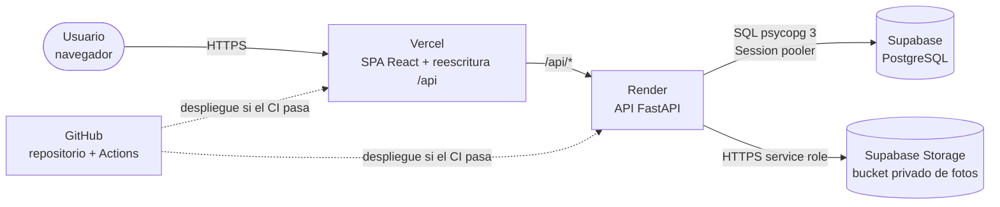
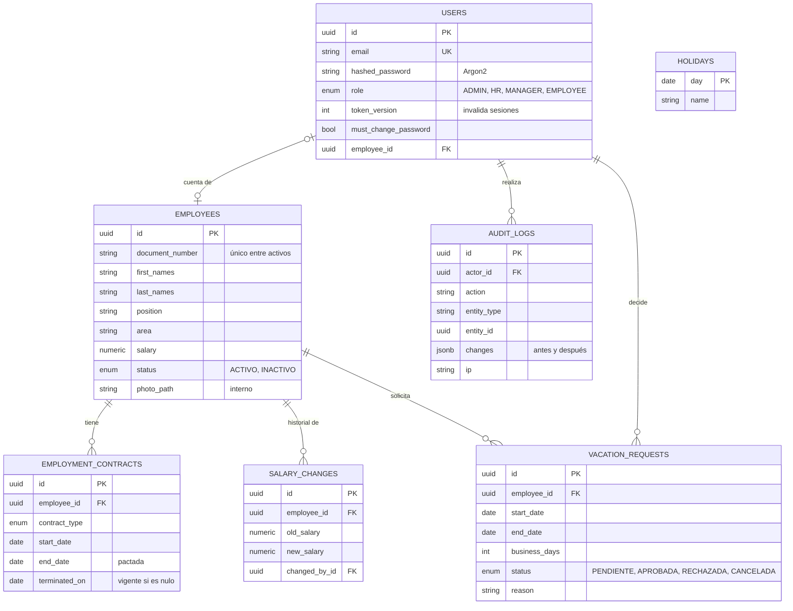
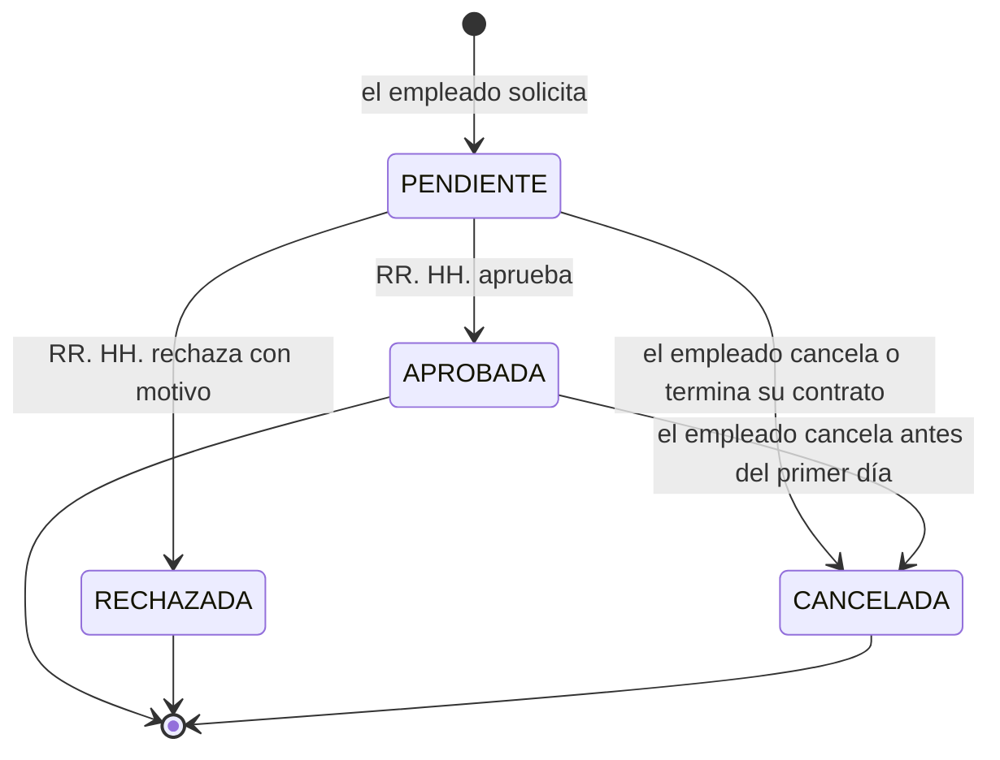
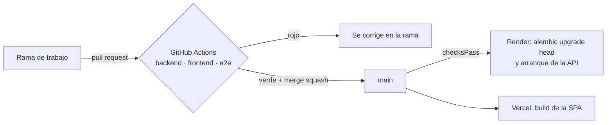

# Arquitectura de TAT

Este documento explica cómo está construido TAT, por qué se tomó cada decisión técnica y cómo se garantiza la calidad. Para el uso de la aplicación, consulta el [manual de usuario](MANUAL_USUARIO.md).

## 1. Visión general

TAT es una aplicación web de página única (SPA) que consume una API REST. El navegador solo habla con un dominio: Vercel sirve la aplicación y reenvía las rutas `/api/*` a la API en Render. Así la cookie de sesión es de primera parte y no hace falta exponer la API con CORS abierto.



| Capa | Tecnología | Responsabilidad |
|---|---|---|
| Presentación | React 19 + TypeScript estricto + Vite | Interfaz por rol, validación de formularios para la experiencia de usuario, rutas protegidas. |
| API | FastAPI (Python 3.12) | Autenticación, autorización por rol, reglas de negocio, validación definitiva y auditoría. |
| Persistencia | PostgreSQL (Supabase) + SQLAlchemy 2 + Alembic | Datos transaccionales y migraciones versionadas. |
| Archivos | Supabase Storage (bucket privado) | Fotos de perfil, servidas solo a través de la API. |

## 2. Backend

### Organización del código

```
backend/app/
├── main.py          # crea la app: CORS, routers y documentación
├── api/             # rutas HTTP (una por módulo) y dependencias de seguridad (deps.py)
├── schemas/         # contratos de entrada y salida (Pydantic): lo único que ve el cliente
├── models/          # tablas (SQLAlchemy ORM)
├── services/        # reglas de negocio (vacaciones, certificado, exportación…)
├── core/            # configuración, JWT, Argon2, límite de intentos, reloj
└── db/              # sesión de base de datos
```

Se mantienen separados los **modelos** (cómo se guarda) y los **esquemas** (qué se expone). Por eso una respuesta nunca puede incluir por accidente `hashed_password` o la ruta interna de una foto: el esquema simplemente no tiene esos campos.

### Módulos de la API

| Prefijo | Qué ofrece | Quién puede usarlo |
|---|---|---|
| `/auth` | Login, logout, sesión actual, cambio de contraseña | Público (login) / autenticado |
| `/employees` | Registro, directorio, expediente, datos laborales, historial salarial, foto, exportación CSV, indicadores y resumen del panel | ADMIN y HR escriben; MANAGER lee |
| `/employees/{id}/contracts` | Contratos, asignación, finalización y alertas de vencimiento | ADMIN y HR escriben; MANAGER lee |
| `/me` | Perfil propio, datos de contacto, foto y certificado laboral | Cualquier usuario autenticado, sobre sí mismo |
| `/vacation-requests`, `/me/vacation-requests` | Solicitud, cancelación, bandeja de aprobación, saldo, calendario y notificaciones | Según la acción |
| `/holidays` | Festivos de Colombia | Todos leen; ADMIN escribe |
| `/audit` | Registro de auditoría | ADMIN |
| `/health` | Estado de la API y de la base de datos | Público |

### Reglas de negocio destacadas

- **Saldo de vacaciones calculado, nunca guardado.** Se causan 15 días hábiles por cada 365 días del contrato vigente, redondeados hacia abajo. El saldo disponible es lo causado menos lo aprobado, y lo que se puede pedir descuenta además lo pendiente. Al calcularlo cada vez, no puede desincronizarse.
- **Días hábiles** = días entre dos fechas sin sábados, domingos ni los festivos registrados. Un festivo agregado después no altera las solicitudes ya hechas: cada solicitud guarda sus días hábiles.
- **Fecha de negocio de Colombia (UTC-5).** El servidor corre en UTC; `core/clock.today()` evita que después de las 7 p. m. "hoy" sea mañana.
- **Concurrencia.** Las operaciones sensibles (aprobar vacaciones, finalizar contratos, cambiar datos laborales) bloquean la fila con `SELECT … FOR UPDATE`, para que dos personas no tomen decisiones sobre el mismo estado.
- **Finalizar un contrato** pasa al empleado a inactivo, cancela sus solicitudes de vacaciones pendientes y cierra sus sesiones abiertas, todo en la misma transacción.

## 3. Modelo de datos



- El esquema se versiona con **15 migraciones de Alembic**. El CI verifica con `alembic check` que el código y las migraciones no diverjan.
- Todas las tablas tienen **Row Level Security** habilitado. Supabase expone por defecto una API de datos pública, y con RLS activo y sin políticas nadie puede leer las tablas por esa vía; solo la API de TAT accede a ellas.
- Un empleado puede tener varios contratos en el tiempo (reingresos), pero solo uno vigente.

### Ciclo de vida de una solicitud de vacaciones



## 4. Frontend

```
frontend/src/
├── pages/       # una pantalla por ruta
├── components/  # piezas reutilizables (tarjetas, calendario, avisos…)
├── api/         # funciones tipadas sobre Axios, una por endpoint
├── auth/        # contexto de sesión, rutas protegidas y por rol
├── types/       # tipos TypeScript que reflejan los esquemas de la API
└── utils/       # días hábiles y eventos entre componentes
```

- **TypeScript en modo estricto**, sin `any` ni archivos JavaScript.
- **Rutas por rol:** `ProtectedRoute` exige sesión y `RoleRoute` limita por rol. Ocultar un botón es solo experiencia de usuario: la API vuelve a validar el rol en cada petición.
- **Diseño adaptable:** se probó a 360, 768, 1366 y 1920 px. En móvil, la navegación pasa a un menú lateral desplegable.
- **Accesibilidad:** etiquetas en todos los campos, avisos en regiones `aria-live`, calendario navegable con teclado y contraste AA en los colores de los avatares.

## 5. Seguridad

| Amenaza | Medida |
|---|---|
| Robo de sesión por XSS | El JWT viaja solo en una cookie `HttpOnly` (JavaScript no puede leerla), `Secure` en producción y `SameSite=Lax`. Nunca se guarda en `localStorage`. |
| CSRF | `SameSite=Lax` y un único origen gracias a la reescritura de Vercel. CORS con orígenes explícitos, nunca `*`. |
| Contraseñas filtradas | Hash Argon2. Contraseña temporal generada por el sistema y cambio obligatorio en el primer acceso. |
| Fuerza bruta | Bloqueo tras 5 intentos fallidos por cuenta o 30 por IP en 15 minutos. |
| Enumeración de usuarios | El mismo mensaje para correo inexistente y contraseña incorrecta. |
| Sesiones tras cambiar la contraseña | `token_version` invalida los tokens anteriores al cambiar o restablecer la contraseña. |
| Escalamiento de privilegios | Autorización por rol en cada endpoint. Un empleado solo accede a `/me`, sin identificadores en la ruta. |
| Datos de entrada maliciosos | Validación con Pydantic en el servidor (`extra="forbid"`). Las fotos se validan por su contenido real, no por la extensión (JPG, PNG o WEBP de hasta 2 MB). |
| Exposición de archivos | Bucket privado: las fotos y el certificado se sirven solo a usuarios autorizados, con `Cache-Control: no-store` en el certificado. |
| Secretos | Solo en variables de entorno (`SecretStr`), nunca en el repositorio ni en los registros. Los errores internos no se devuelven al cliente. |
| Trazabilidad | 18 tipos de acción auditados con autor, IP y valores antes y después; el certificado guarda su código de verificación. |
| Dependencias vulnerables | Revisión con `pip-audit` y `npm audit` antes de entregar. |

## 6. Despliegue



- **Render** ejecuta las migraciones antes de arrancar: si una falla, la versión anterior sigue atendiendo. Solo despliega commits de `main` cuyo CI pasó (`autoDeployTrigger: checksPass`).
- **Vercel** compila la SPA y reenvía `/api/*` a Render.
- La API está en la misma región que la base de datos (us-east-1) para no sumar latencia a cada consulta.
- La guía paso a paso está en [DEPLOYMENT.md](DEPLOYMENT.md).

## 7. Calidad

| Nivel | Herramienta | Alcance |
|---|---|---|
| Análisis estático | Ruff, mypy, `tsc` estricto | Estilo y tipos en backend y frontend. |
| Pruebas de la API | pytest (32 archivos) | Reglas de negocio, permisos por rol, validaciones y auditoría. Cada prueba corre en una transacción que se revierte. |
| Extremo a extremo | Playwright (22 archivos de pruebas) | Flujos completos en Chromium contra la API y una base de datos reales, por rol. Ver [E2E.md](E2E.md). |
| Revisión visual | Capturas a 4 anchos y 4 roles | Desbordes, ancho aprovechado y estados interactivos (diálogos, avisos, esqueletos). |

## 8. Proceso de desarrollo

- **Scrum en Azure DevOps:** Épica → Feature → Historia de usuario → Tarea (`BACK_`, `FRONT_`, `QA_`), cinco sprints con criterios de aceptación por historia.
- **GitHub Flow:** una rama corta por tarea (`tipo/<id>-descripcion`), pull request con el CI en verde, merge squash y commits convencionales (`feat:`, `fix:`, `test:`…). Cada PR enlaza su tarea con `AB#<id>`.
- **Definición de terminado:** backend, frontend y pruebas cumplen los criterios de aceptación de la historia.

| Sprint | Historias principales | Puntos |
|---|---|---|
| 1 | Inicio y cierre de sesión, registro de empleado | 15 |
| 2 | Creación de cuentas, búsqueda, expediente, indicadores del panel | 15 |
| 3 | Primer acceso, reset de contraseña, perfil propio, contratos, auditoría, despliegue | 28 |
| 4 | Datos laborales, historial salarial, vacaciones (solicitud, aprobación, saldo, calendario), exportación | 25 |
| 5 | Cancelación, festivos, notificaciones, calendario por área, certificado laboral | 16 |
