# Manual de usuario de TAT

TAT centraliza la gestión del talento humano: empleados, contratos, vacaciones y auditoría. Este manual explica cómo usarlo según tu rol. Para saber cómo está construido, consulta la [arquitectura](ARQUITECTURA.md).

**Dirección de la aplicación:** https://tat-woad.vercel.app

## Contenido

1. [Acceso](#1-acceso)
2. [Qué ve cada rol](#2-qué-ve-cada-rol)
3. [Panel principal](#3-panel-principal)
4. [Empleados](#4-empleados)
5. [Mi perfil y certificado laboral](#5-mi-perfil-y-certificado-laboral)
6. [Vacaciones](#6-vacaciones)
7. [Administración: festivos y auditoría](#7-administración-festivos-y-auditoría)
8. [Uso en el celular](#8-uso-en-el-celular)
9. [Preguntas frecuentes](#9-preguntas-frecuentes)

## 1. Acceso

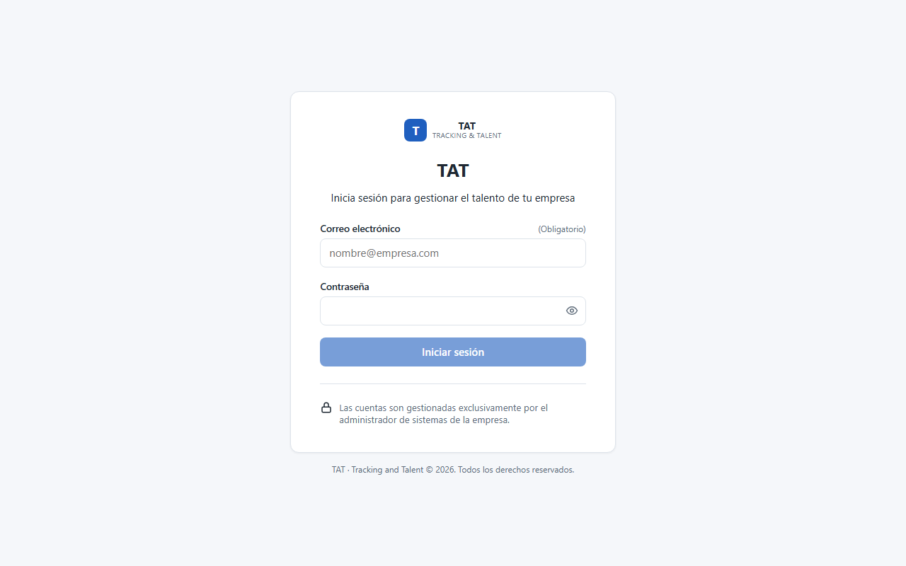

1. Ingresa tu correo y tu contraseña, y pulsa **Iniciar sesión**.
2. **Primer acceso:** si un administrador te creó la cuenta, tu contraseña es temporal. El sistema te pedirá cambiarla antes de continuar: debe tener al menos 8 caracteres y no puede ser igual a la temporal.
3. Si escribes mal los datos, verás el mismo mensaje para un correo o una contraseña incorrectos. Tras varios intentos fallidos, el acceso se bloquea por unos minutos.
4. Para salir, pulsa **Cerrar sesión** en la parte superior derecha. Por seguridad, la sesión dura 30 minutos; después de ese tiempo debes iniciar sesión de nuevo.

> ¿Olvidaste tu contraseña? Pídele a un administrador que la restablezca desde tu expediente. Recibirás una nueva contraseña temporal.

## 2. Qué ve cada rol

| Opción del menú | Administrador | Recursos Humanos | Gerente | Empleado |
|---|:-:|:-:|:-:|:-:|
| Panel principal | ✔ | ✔ | ✔ | |
| Empleados (directorio y expediente) | ✔ | ✔ | Solo lectura | |
| Registrar empleado | ✔ | ✔ | | |
| Calendario de ausencias | ✔ | ✔ | ✔ | |
| Solicitudes de vacaciones (aprobar o rechazar) | ✔ | ✔ | | |
| Mi perfil y Mis vacaciones | ✔ | ✔ | ✔ | ✔ |
| Festivos y Auditoría | ✔ | | | |
| Crear cuentas y restablecer contraseñas | ✔ | | | |

Al iniciar sesión, cada rol llega a su pantalla principal: el panel para administración, RR. HH. y gerencia, y **Mi perfil** para los empleados.

## 3. Panel principal

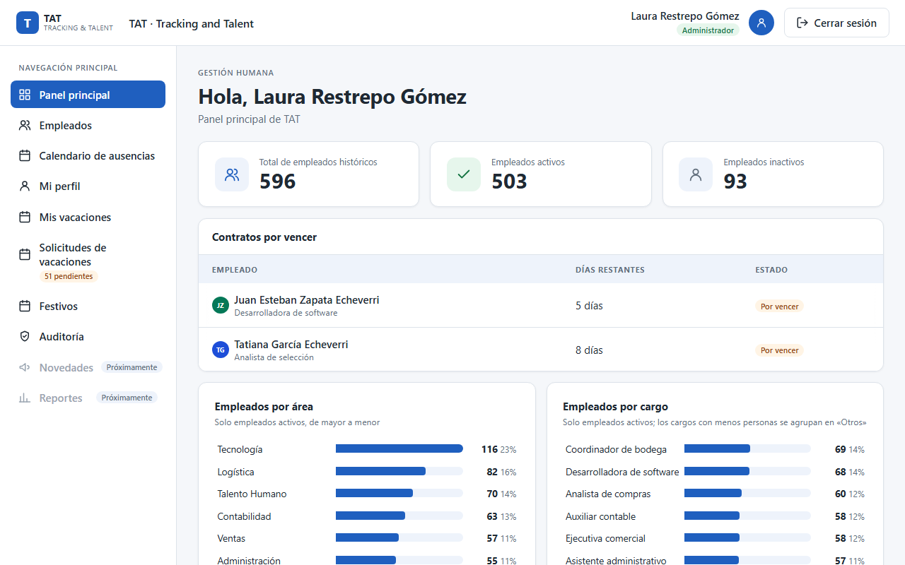

- **Indicadores:** total histórico de empleados, activos e inactivos. Se actualizan solos cada 30 segundos.
- **Contratos por vencer:** contratos que terminan en los próximos 30 días, y los ya vencidos, con los días restantes. Haz clic en un nombre para abrir su expediente.
- **Empleados por área y por cargo:** distribución de los empleados activos. Los cargos con pocas personas se agrupan en «Otros».
- **Ingresos y salidas recientes.**
- **Aniversarios del mes:** quién cumple años en la empresa este mes. El día del aniversario se destaca con «¡Hoy!».

## 4. Empleados

### Directorio

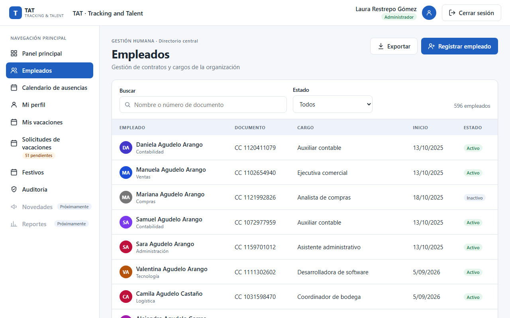

- **Buscar** por nombre o número de documento, y **filtrar** por estado (activo o inactivo).
- Los resultados se muestran por páginas de 10, con **Anterior** y **Siguiente**.
- **Exportar** descarga un archivo CSV con los empleados que cumplen el filtro actual. La exportación queda registrada en la auditoría.

### Registrar un empleado (Administrador y RR. HH.)

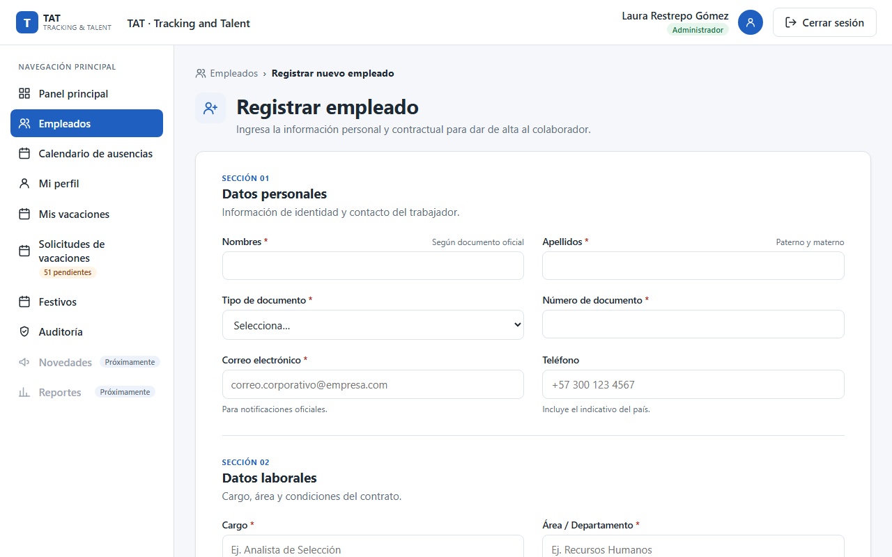

1. En **Empleados**, pulsa **Registrar empleado**.
2. Completa los **datos personales** (nombres, apellidos, documento, correo y teléfono) y los **datos laborales** (cargo, área, salario, tipo de contrato y fechas).
   - Los contratos **a término fijo**, **de obra o labor** y **de aprendizaje** requieren fecha de finalización; los **indefinidos** no la llevan.
   - Todo empleado nuevo queda **activo**.
3. *(Solo Administrador)* En **Acceso al sistema** puedes crearle una cuenta y elegir su rol. Al guardar, verás **una única vez** la contraseña temporal para entregársela. Por seguridad, el sistema no la vuelve a mostrar.
4. Pulsa **Guardar empleado**. Si el documento ya pertenece a un empleado activo, el sistema te lo indicará.

### Expediente

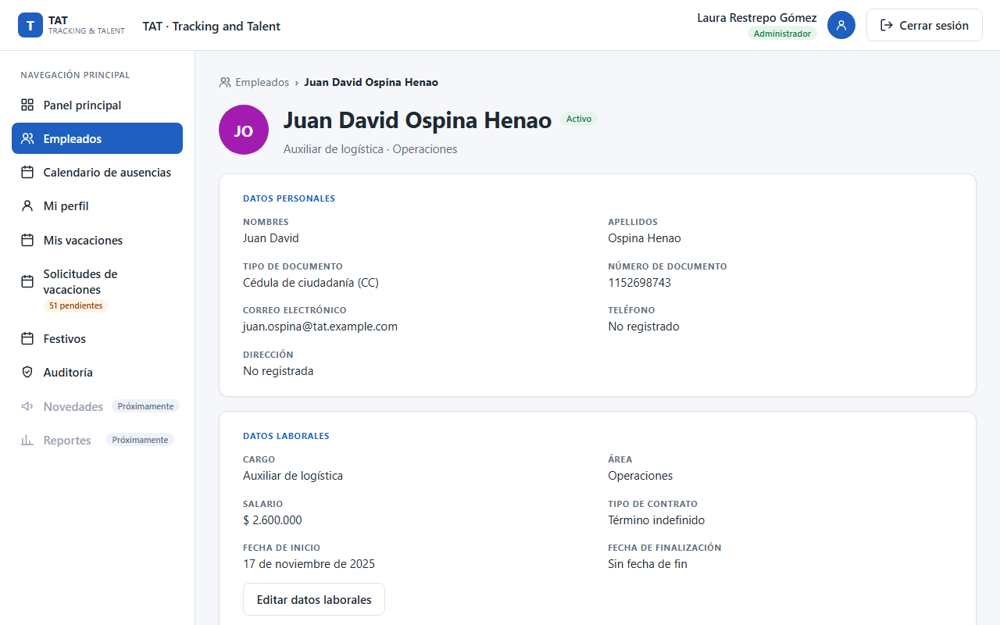

En el expediente están los datos personales y laborales, el saldo de vacaciones, el historial salarial y los contratos. Según tu rol puedes:

- **Editar datos laborales:** cargo, área y salario. Cada cambio de salario queda en el **historial salarial** con la fecha y quién lo hizo.
- **Asignar nuevo contrato** o **Registrar reingreso** (si el empleado está inactivo).
- **Finalizar contrato:** indica la fecha de retiro. El empleado pasa a inactivo, sus solicitudes de vacaciones pendientes se cancelan y, si tiene cuenta, sus sesiones se cierran.
- *(Administrador)* **Restablecer contraseña** genera una nueva contraseña temporal.

El Gerente ve toda esta información, pero sin botones de edición.

## 5. Mi perfil y certificado laboral

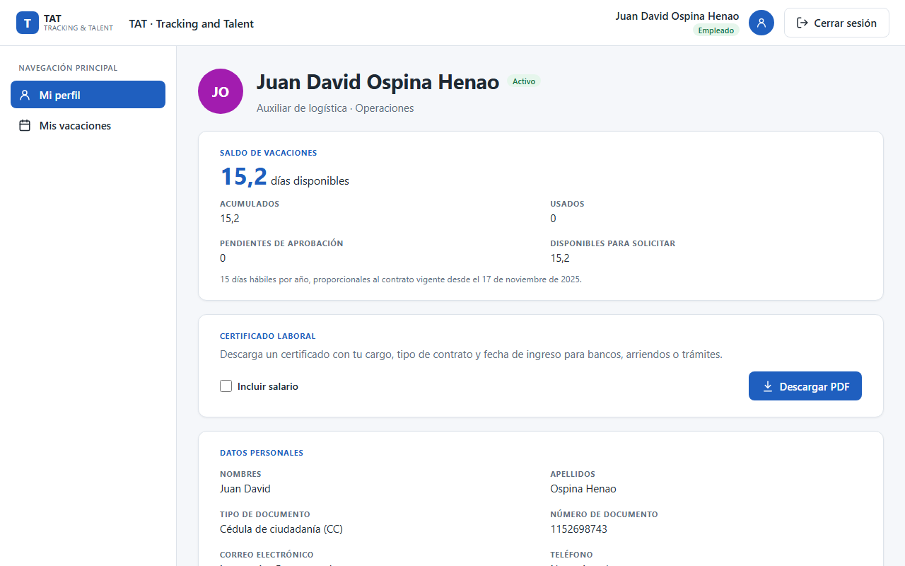

- Consulta tus datos personales, laborales y tu **saldo de vacaciones**.
- En **Actualizar mis datos de contacto** puedes cambiar tu teléfono, tu dirección y tu **foto de perfil** (JPG, PNG o WEBP de hasta 2 MB). Los demás datos solo los cambia RR. HH.
- **Certificado laboral:** marca **Incluir salario** si lo necesitas y pulsa **Descargar PDF**. El certificado incluye tu cargo, área, tipo de contrato y fecha de ingreso, más un **código de verificación** al pie que queda registrado en la auditoría. Solo pueden descargarlo los empleados activos con un contrato vigente.

## 6. Vacaciones

### Saldo

Se causan **15 días hábiles por cada año** del contrato vigente, en proporción al tiempo trabajado. El saldo muestra:

| Dato | Significado |
|---|---|
| Acumulados | Días causados desde el inicio del contrato vigente. |
| Usados | Días de solicitudes aprobadas. |
| Pendientes de aprobación | Días de solicitudes que esperan respuesta. |
| Disponibles para solicitar | Acumulados − usados − pendientes. |

### Solicitar vacaciones (todos los roles)

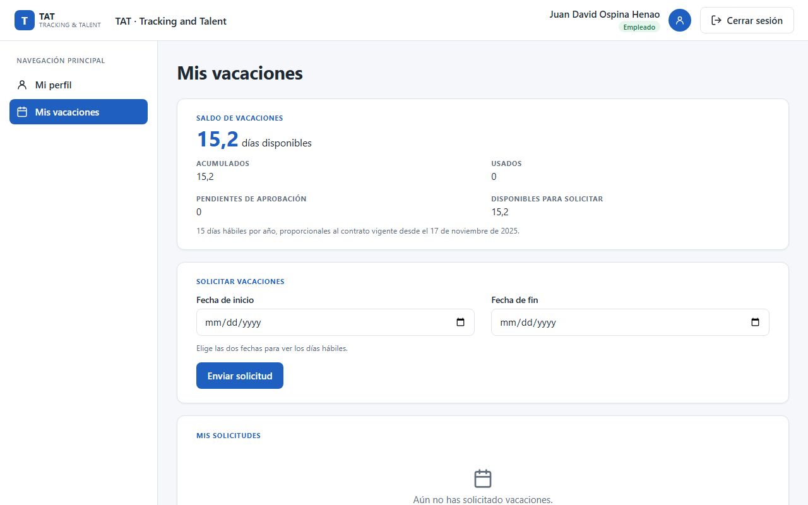

1. En **Mis vacaciones**, elige la fecha de inicio y la de fin. El sistema calcula los **días hábiles**: no cuenta sábados, domingos ni festivos de Colombia.
2. Pulsa **Enviar solicitud**. No puedes pedir más días de los disponibles ni fechas que se crucen con otra solicitud tuya.
3. En **Mis solicitudes** sigues el estado: pendiente, aprobada, rechazada (con el motivo) o cancelada.
4. Puedes **cancelar** una solicitud pendiente, o una aprobada que todavía no haya empezado.
5. Cuando RR. HH. responde, verás un aviso en el menú.

### Aprobar o rechazar (Administrador y RR. HH.)

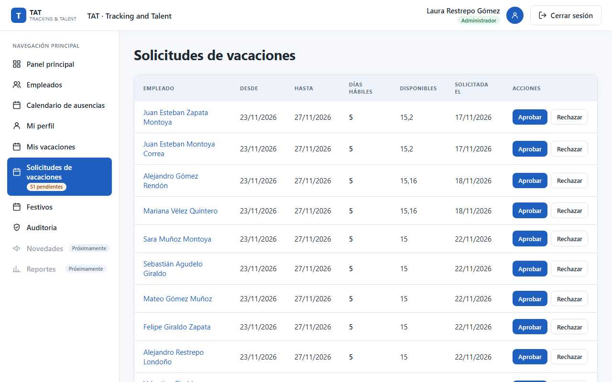

- En **Solicitudes de vacaciones** aparecen las pendientes, con los días hábiles y el saldo disponible de cada persona. El menú muestra cuántas hay sin atender.
- **Aprobar** descuenta los días del saldo.
- **Rechazar** pide un motivo, que el empleado verá.

### Calendario de ausencias (Administrador, RR. HH. y Gerente)

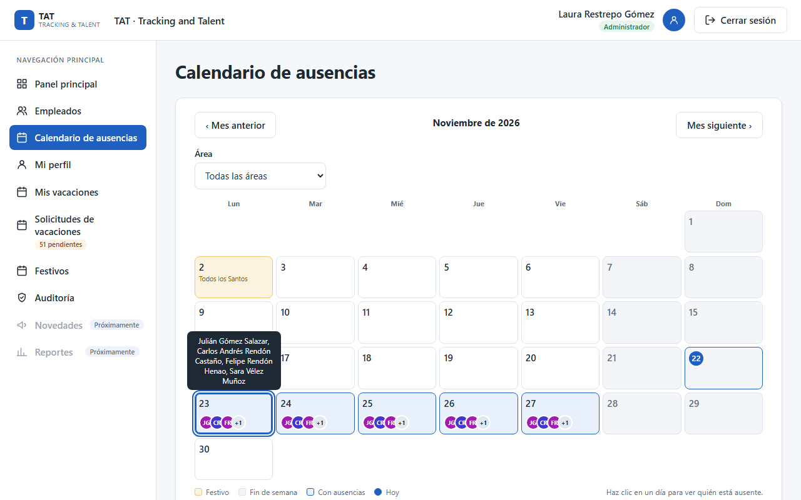

- Cada día muestra los **avatares** de quienes están de vacaciones aprobadas. Pasa el cursor sobre un día para ver los nombres.
- Haz clic en un día para saber cuántas personas faltan y resaltar sus tarjetas en **Ausencias del mes**.
- Filtra por **área** y navega con **Mes anterior** y **Mes siguiente**.
- Los festivos aparecen en amarillo y el día de hoy, marcado en azul.

## 7. Administración: festivos y auditoría

### Festivos (Administrador)

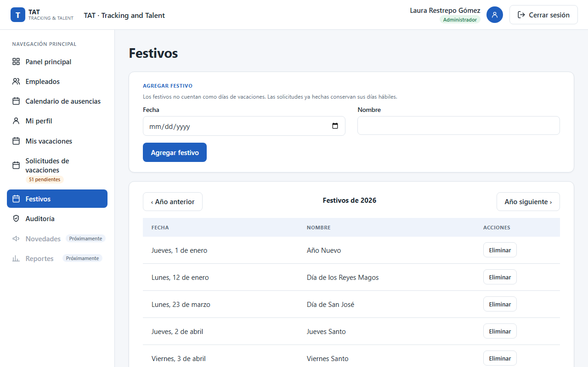

- Agrega un festivo con su fecha y su nombre, o elimínalo de la lista del año.
- Los festivos no cuentan como días de vacaciones. Las solicitudes ya hechas conservan los días hábiles con que se crearon.

### Auditoría (Administrador)

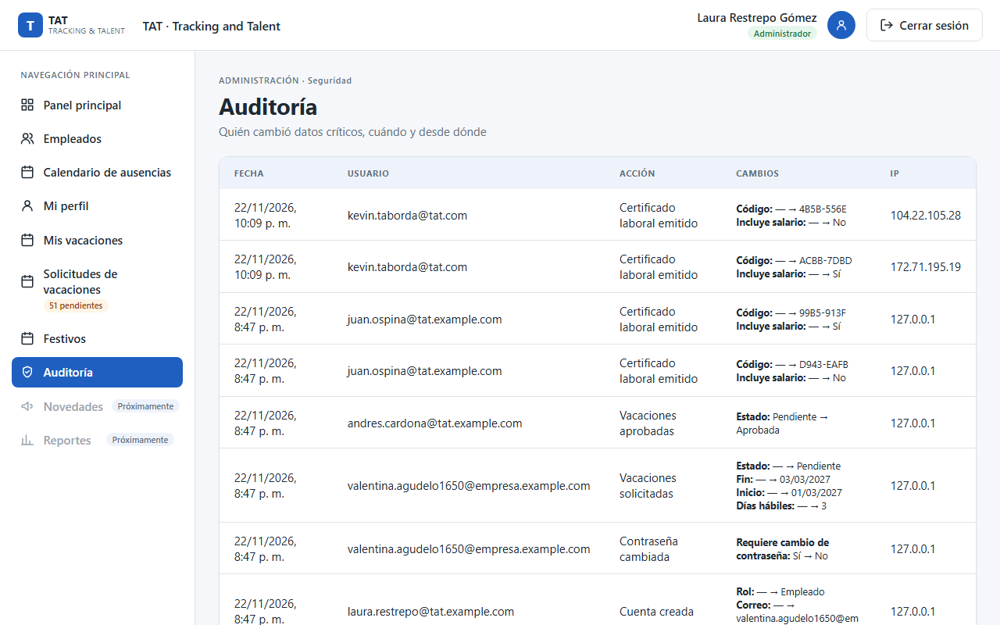

Registra quién hizo cada cambio importante, cuándo, desde qué IP, y los valores anteriores y nuevos. Incluye registros de empleados, contratos, cambios de salario, cuentas y contraseñas, vacaciones, festivos, exportaciones y certificados emitidos.

## 8. Uso en el celular

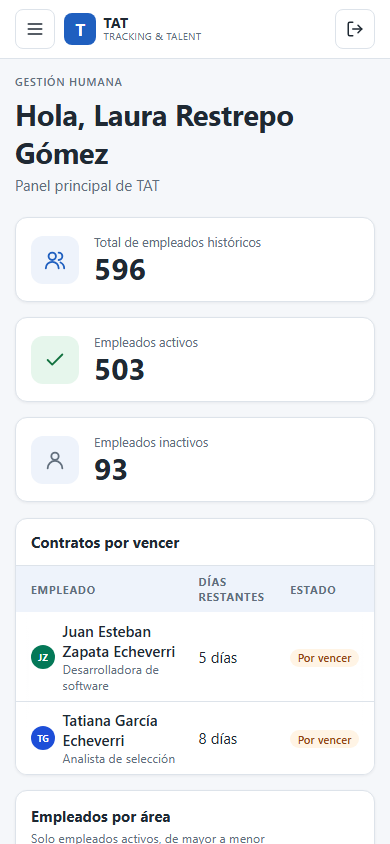

TAT se adapta a pantallas pequeñas. El menú se abre con el botón ☰ de la esquina superior izquierda, y las tablas anchas se desplazan horizontalmente.

## 9. Preguntas frecuentes

**No puedo iniciar sesión.** Revisa el correo y la contraseña. Si hiciste varios intentos fallidos, espera unos minutos. Si olvidaste la contraseña, un administrador puede restablecerla.

**No veo una opción del menú.** Las opciones dependen de tu rol (ver [sección 2](#2-qué-ve-cada-rol)).

**¿Por qué mi solicitud tiene menos días de los que conté?** Solo se cuentan los días hábiles: los fines de semana y los festivos no se descuentan del saldo.

**No puedo descargar el certificado.** Solo está disponible para empleados activos con un contrato vigente. Si tu caso es distinto, consulta con RR. HH.
